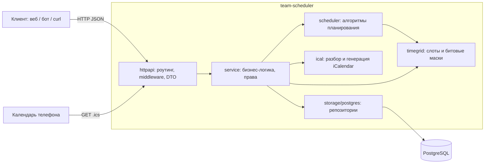
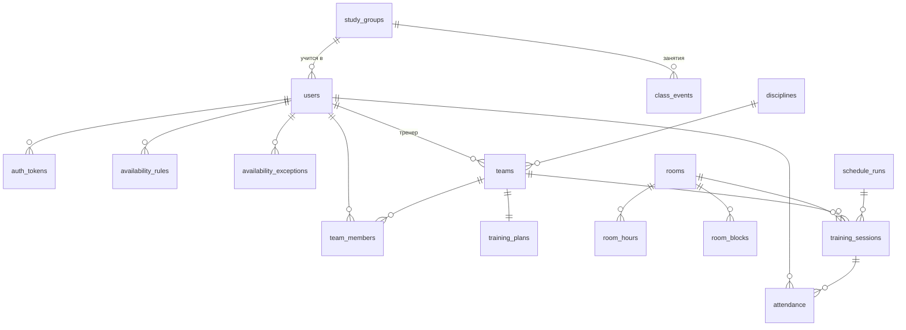

# Архитектура

## 1. Общая схема

Система — один backend-сервис на Go с REST API и базой PostgreSQL. Клиенты (веб-интерфейс, Telegram-бот, календари через iCalendar) работают только через API.



## 2. Слои и пакеты

| Пакет | Ответственность | Зависит от |
|---|---|---|
| `cmd/server` | Точка входа: конфиг, логгер, БД, миграции, HTTP-сервер, graceful shutdown | всё ниже |
| `cmd/experiment` | Генератор синтетических задач и сравнение алгоритмов | `scheduler`, `timegrid` |
| `internal/config` | Чтение конфигурации из переменных окружения | — |
| `internal/domain` | Сущности предметной области и доменные ошибки | — |
| `internal/timegrid` | Неделя, слоты по 30 минут, битовая маска на 336 слотов | — |
| `internal/scheduler` | Генерация кандидатов, целевая функция, жадный алгоритм, метод ветвей и границ. Чистые функции без ввода-вывода | `timegrid` |
| `internal/scheduler/synth` | Генератор синтетических задач для тестов, бенчмарков и эксперимента | `scheduler`, `timegrid` |
| `internal/ical` | Разбор iCalendar (VEVENT, RRULE WEEKLY, EXDATE) и экспорт | — |
| `internal/service` | Сценарии использования: проверка прав, сбор входных данных для планировщика, транзакции | `domain`, `scheduler`, `ical`, интерфейсы хранилища |
| `internal/storage/postgres` | Реализация репозиториев на pgx, транзакции | `domain` |
| `internal/httpapi` | Маршруты, middleware, сериализация, отображение ошибок в HTTP-коды | `service`, `domain` |
| `migrations` | SQL-миграции, встроенные в бинарник через `embed` | — |

Правило зависимостей: слои зависят только «вниз». Интерфейсы хранилища объявлены в пакете `service` (на стороне потребителя), поэтому сервисы тестируются с фейковыми репозиториями без БД.

## 3. Модель данных



| Таблица | Назначение |
|---|---|
| `users` | Пользователи: e-mail, bcrypt-хэш пароля, ФИО, роль, учебная группа |
| `auth_tokens` | Токены доступа: SHA-256 от токена, срок действия |
| `study_groups` | Учебные группы |
| `class_events` | Занятия групп, развёрнутые из RRULE в конкретные интервалы |
| `disciplines` | Дисциплины и размер основного состава |
| `teams`, `team_members` | Команды и состав (core или substitute, позиция) |
| `training_plans` | Тренировочный план команды на микроцикл |
| `availability_rules` | Еженедельная доступность игрока («могу» или «предпочитаю») |
| `availability_exceptions` | Исключения на конкретные даты |
| `rooms`, `room_hours`, `room_blocks` | Залы, часы работы, блокировки |
| `schedule_runs` | Запуски генерации: неделя, алгоритм, статус, значение целевой функции, статистика (jsonb) |
| `training_sessions` | Тренировки: команда, зал, интервал, занятые места, статус |
| `attendance` | Посещаемость |

## 4. Ключевые решения

### 4.1. Время как битовые маски

Неделя — 336 слотов по 30 минут, любое множество слотов — `[6]uint64`. Пересечение доступности пяти игроков — пять операций AND по 6 слов. Это делает генерацию кандидатов дешёвой и упрощает код: «игрок свободен весь интервал» — это `interval.AndNot(free).IsEmpty()`.

Перевод времени в слот идёт через локальное «настенное» время в часовом поясе киберцентра (день недели, часы, минуты). Поэтому расчёт не зависит от смещения UTC.

### 4.2. Повторяющиеся занятия разворачиваются при импорте

RRULE разворачивается в конкретные занятия на период импорта (обычно семестр). Плюсы: запросы «занятия группы за неделю» — простой диапазонный запрос по индексу, легко удалить или перенести одно занятие, повторный импорт периода атомарно заменяет данные в транзакции.

### 4.3. Вместимость зала проверяется в транзакции под блокировкой

Ограничение-исключение PostgreSQL (`EXCLUDE USING gist`) не подходит: в зале на 20 мест одновременно могут заниматься две команды по 5 человек, то есть ограничение не «не пересекаться», а «сумма мест ≤ вместимости». Поэтому публикация:

1. открывает транзакцию и блокирует запуск (`SELECT … FOR UPDATE`), чтобы его нельзя было опубликовать дважды;
2. блокирует строки затронутых залов (`SELECT … FOR UPDATE`): параллельные публикации в тот же зал выполняются последовательно;
3. отменяет прежние опубликованные тренировки этих команд на неделю;
4. проверяет вместимость по каждому слоту с учётом уже опубликованных тренировок других команд, а также блокировки залов, добавленные после генерации;
5. переводит тренировки черновика в `published`.

Конфликт возвращается клиенту как 409 с понятной причиной («в зале не хватает мест 09.11 18:00»), транзакция откатывается целиком. Интеграционный тест `TestConcurrentPublishIsSerialized` запускает две конфликтующие публикации одновременно и проверяет, что успешна ровно одна.

### 4.4. Транзакции через контекст

Границы транзакции определяет сервисный слой (публикация — бизнес-операция), но сервисы не должны зависеть от pgx. Поэтому `Store.InTx(ctx, fn)` кладёт `pgx.Tx` в `context.Context`, а каждый метод хранилища берёт исполнитель запросов из контекста: транзакцию, если она есть, иначе пул. Интерфейс в сервисе — `InTx(ctx, func(ctx) error) error`, без типов драйвера. Вложенный `InTx` переиспользует внешнюю транзакцию.

### 4.5. Непрозрачные токены вместо JWT

Токен — 32 случайных байта (base64url), в БД хранится только SHA-256. Плюсы перед JWT для этого проекта: мгновенный отзыв (logout, блокировка пользователя), нет секрета подписи, который можно утечь, нет вопросов с ротацией ключей. Минус — запрос к БД на каждый вызов API, для нагрузки киберцентра это несущественно.

### 4.6. Стандартная библиотека для HTTP

Маршрутизатор `net/http` (шаблоны вида `GET /api/v1/teams/{id}`) покрывает все потребности. Внешний фреймворк не нужен, зависимостей меньше.

### 4.7. Минимум зависимостей

| Зависимость | Зачем |
|---|---|
| `github.com/jackc/pgx/v5` | Драйвер PostgreSQL и пул соединений |
| `github.com/pressly/goose/v3` | Миграции схемы |
| `golang.org/x/crypto/bcrypt` | Хэширование паролей |

iCalendar разбирается собственным пакетом: нужно подмножество RFC 5545, а свой код проще проверить тестами и объяснить на защите.

## 5. Сценарий генерации и публикации

```mermaid
sequenceDiagram
    actor Admin as Администратор
    participant API as httpapi
    participant PS as service.Planning
    participant DB as PostgreSQL
    participant S as scheduler

    Admin->>API: POST /api/v1/schedule/runs {week_start, algorithm, team_ids}
    API->>PS: Generate(...)
    PS->>DB: команды, планы, составы, пары, доступность, залы, блокировки, опубликованные тренировки
    PS->>PS: сборка масок доступности и вместимости
    PS->>S: Solve(problem, algorithm)
    S-->>PS: решение + статистика
    PS->>DB: INSERT schedule_run (draft) + training_sessions (draft)
    API-->>Admin: черновик с тренировками и статистикой

    Admin->>API: POST /api/v1/schedule/runs/{id}/publish
    API->>PS: Publish(id)
    PS->>DB: BEGIN; SELECT rooms FOR UPDATE; cancel old; check capacity; publish; COMMIT
    API-->>Admin: 200 или 409 при конфликте
```

## 6. Обработка ошибок

Доменные ошибки (`domain.ErrNotFound`, `ErrConflict`, `ErrForbidden`, `ErrUnauthorized`, `ErrValidation`) поднимаются из сервисов и в одном месте превращаются в HTTP-статусы: 404, 409, 403, 401, 422. Ответ об ошибке всегда имеет вид `{"error": {"code": "...", "message": "..."}}`. Внутренние ошибки логируются с request id, клиенту отдаётся 500 без подробностей.
